# OpticManager Architecture

This document provides visual diagrams to understand the OpticManager project architecture.

## System Architecture

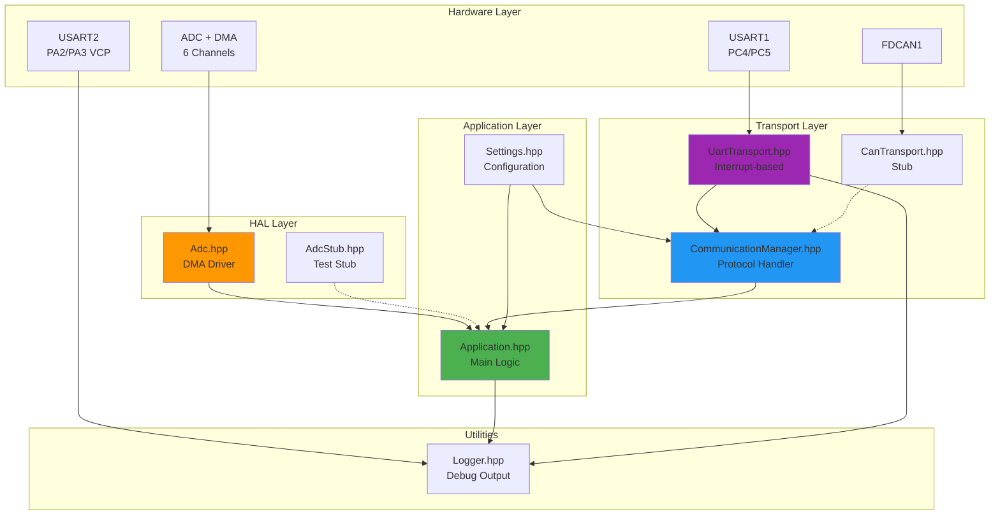

## Class Diagram

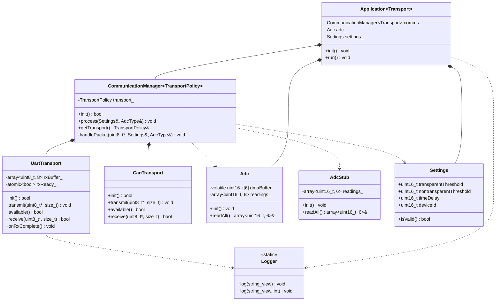

## UART Communication Sequence

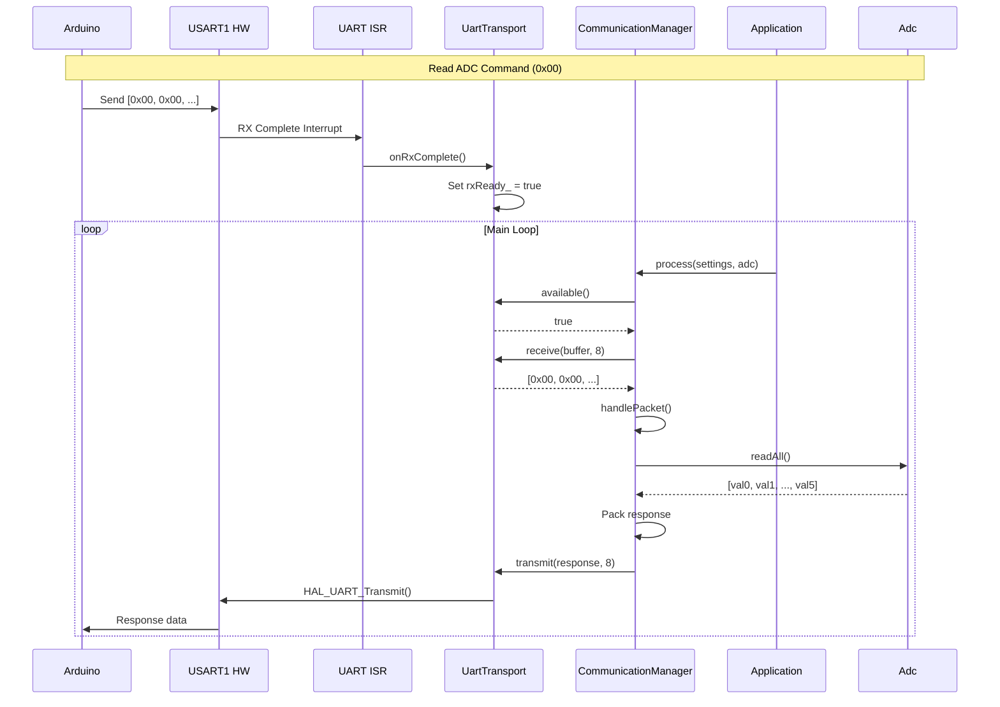

## Sensor State Machine

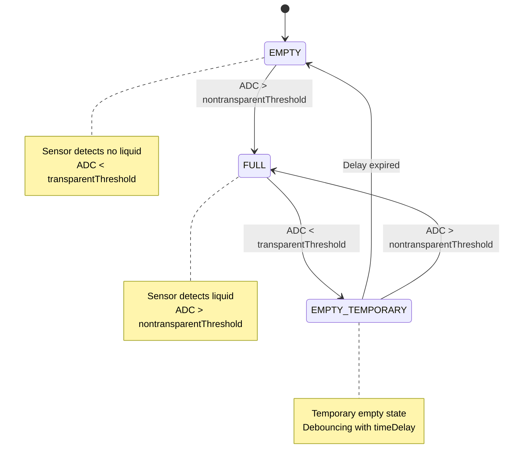

## Data Flow Diagram

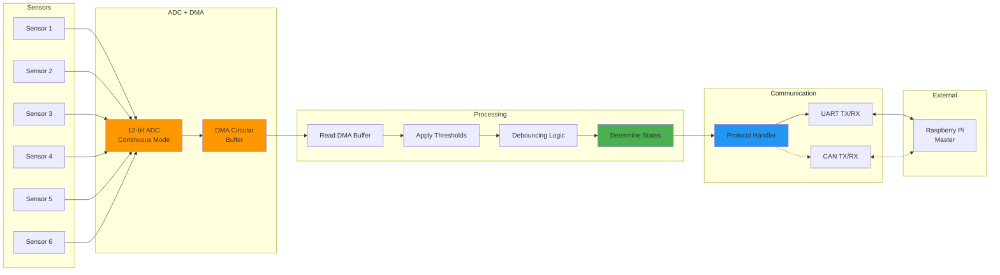

## Memory Layout

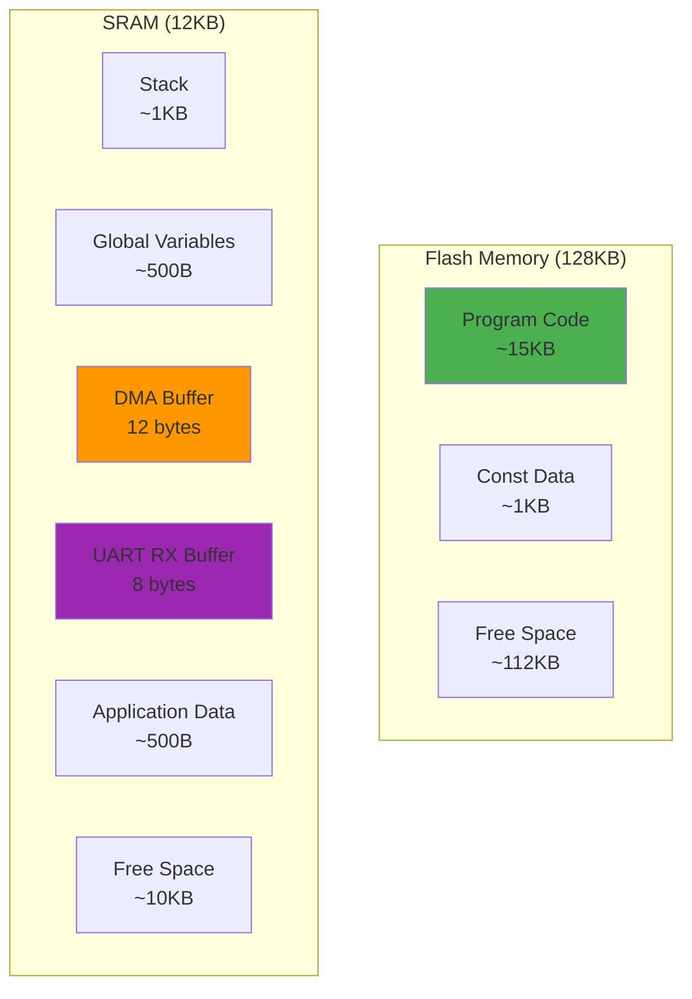

## Interrupt Priority

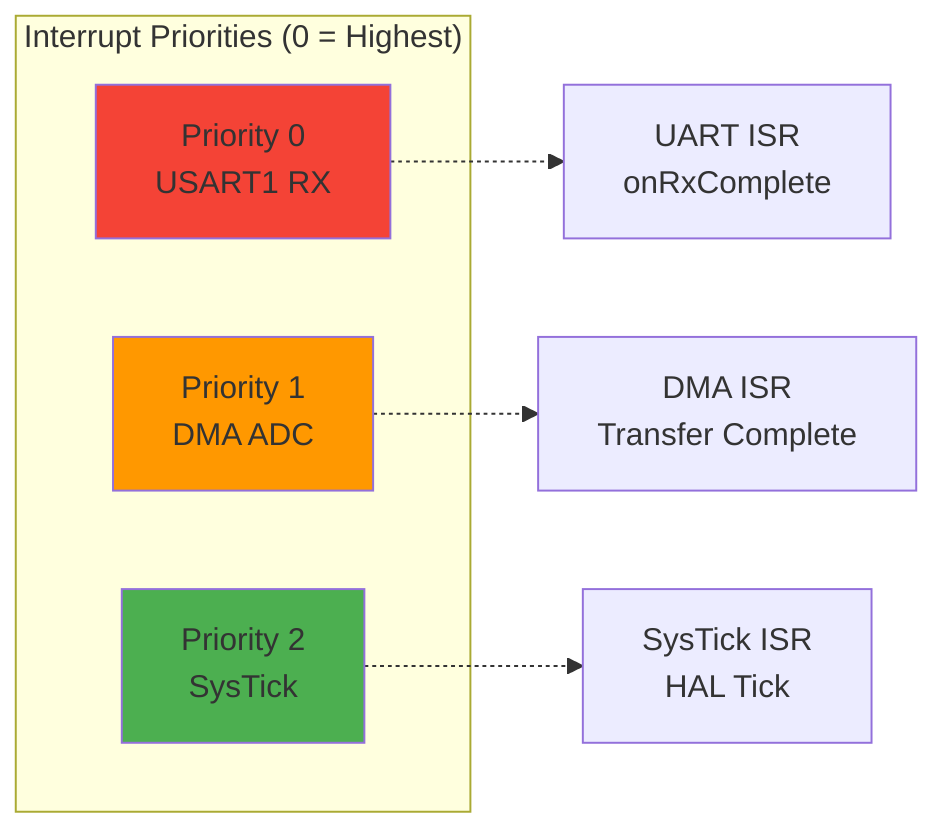

## Build Process

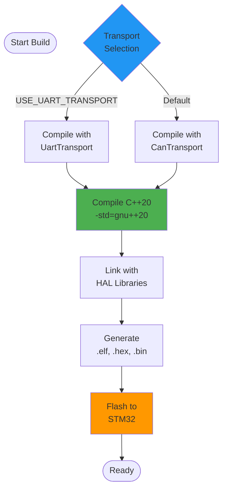

## Protocol Timing Diagram

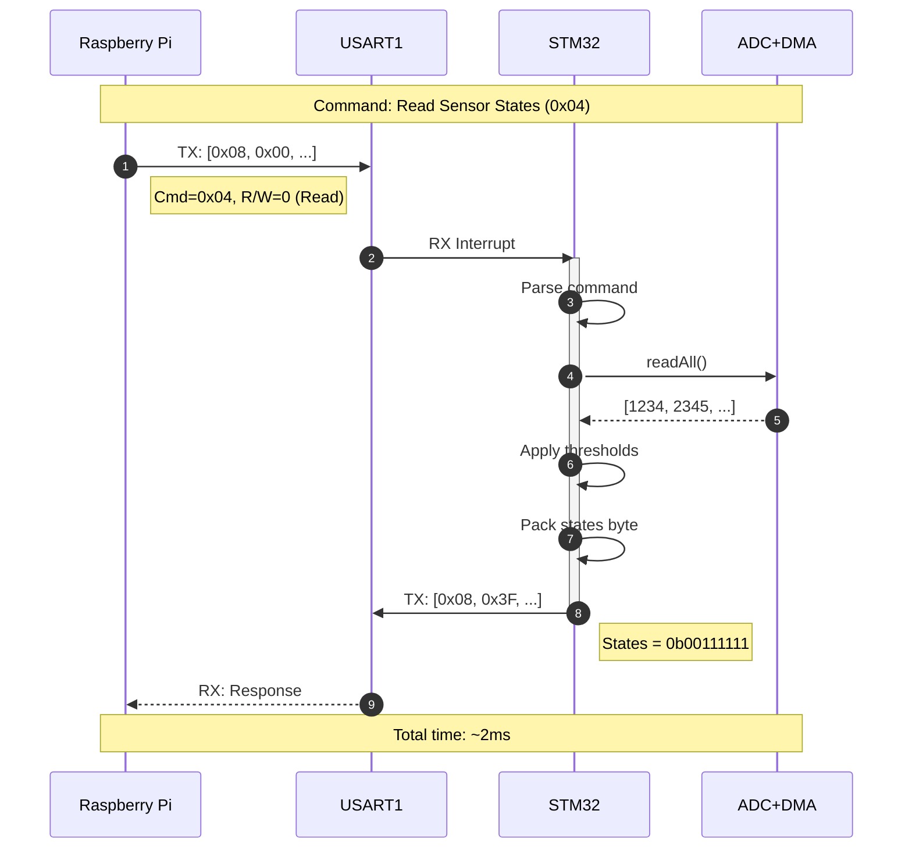

## Component Interaction Diagram

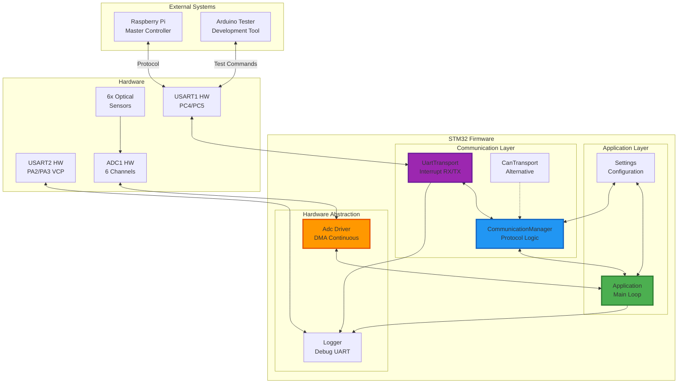

## Deployment Diagram

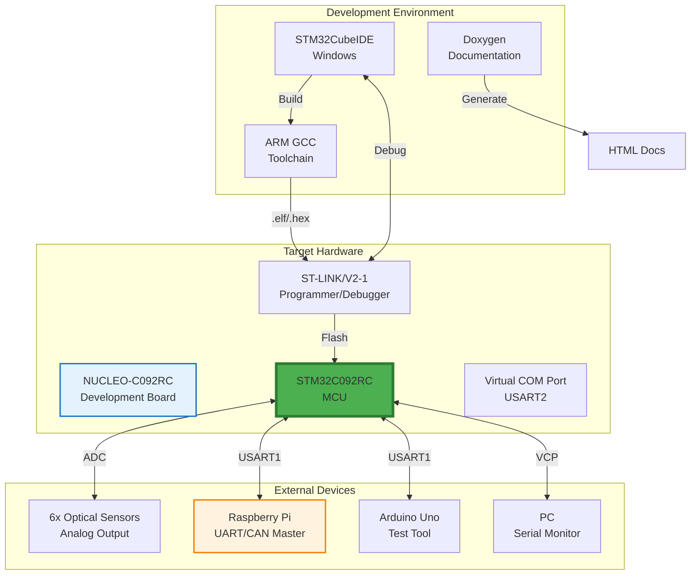

## Template Instantiation Diagram

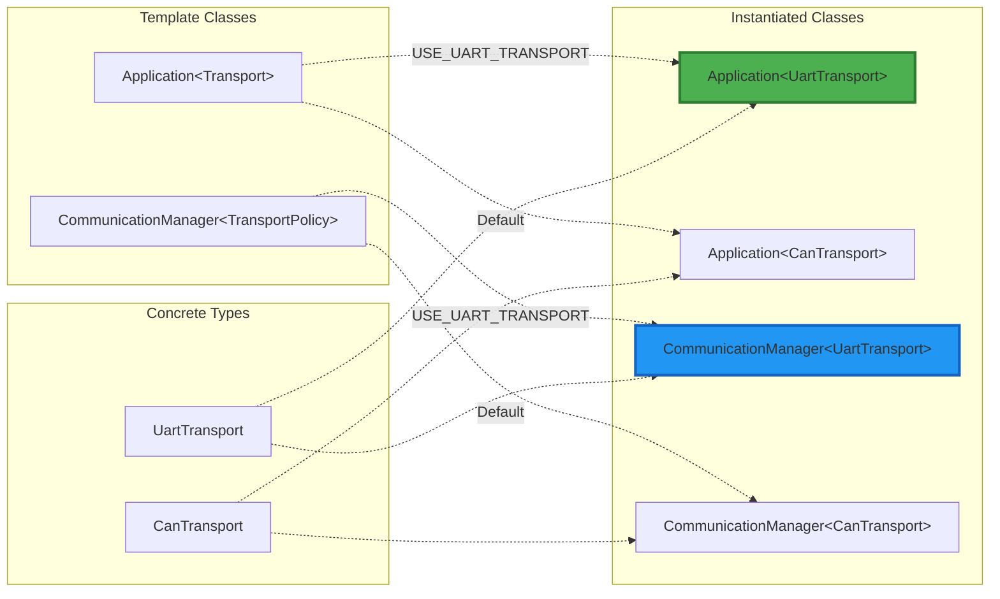

## Error Handling Flow

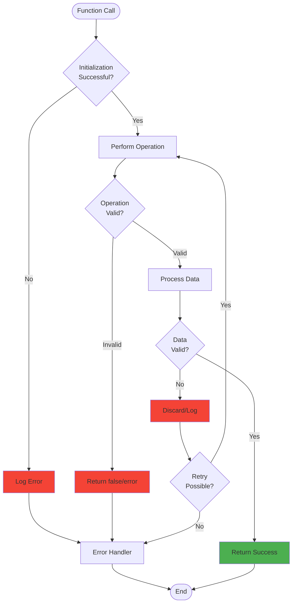

