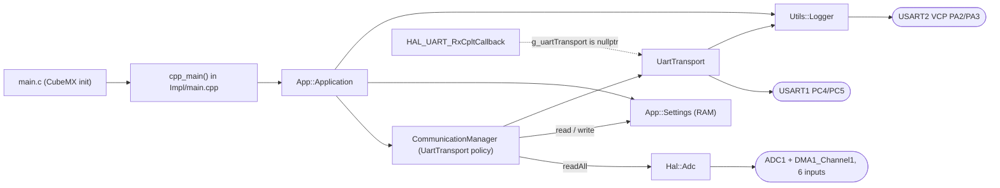

# OpticManager Documentation

This directory contains the auto-generated Doxygen documentation for the OpticManager project.
This page is also the documentation hub for the project.

OpticManager is C/C++20 firmware for the STM32C092RC on a NUCLEO-C092RC board
(`../OpticManager.ioc:6,39`). It samples six analog optical-sensor inputs with ADC1 and DMA. It
answers an 8-byte read/write protocol on USART1 and prints a debug log on USART2. The protocol
gives raw ADC values, a thresholded sensor state mask, two liquid-sensitivity thresholds, a time
delay and a device ID. A CAN variant is selectable at compile time but is a stub. Who the users
are, and which installation the device serves, is not stated in the repository (see
[SPEC.md section 9](../SPEC.md#9-open-questions)).

## Status

- **Last commit:** `5feba9c`, 2025-11-22 (`git log -1`). Branch `dev` contains only this commit.
  `origin/release` is 17 commits ahead (2026-11-08). It adds files that are not here, for example
  `tests/communication_manager_test.cpp`, `docs/install.md`, `docs/manual.md`
  (`git diff --stat origin/dev origin/release`). This page describes `5feba9c` only.
- **Tests:** no automated tests. The one test artefact is the manual Arduino sketch
  [`Tests/ArduinoTester/ArduinoTester.ino`](../Tests/ArduinoTester/ArduinoTester.ino).
- **CI:** none in this commit (no workflow files in `git ls-files`).
- **Unfinished:** 2 `TODO`, 0 `FIXME`. The TODOs are debounce/threshold logic
  (`Core/Src/Impl/App/Application.hpp:36`) and LED update (`Application.hpp:44`). Also unfinished:
  `CanTransport` is a stub in all four methods (`Core/Src/Impl/Drivers/Transport/CanTransport.hpp:11-32`);
  command 0x04 is marked "dummy implementation" (`CommunicationManager.hpp:118`); `_getentropy` is a
  stub (`Core/Src/Impl/main.cpp:28-36`).
- **Defects found while writing this page:** see [Known limitations](#known-limitations-and-problems), items 1 and 2.

## Layout

| Path | Content |
|---|---|
| `Core/Src/main.c` | CubeMX-generated start-up: clock, GPIO, DMA, ADC1, FDCAN1, USART1/2 init, then `cpp_main()` |
| `Core/Src/Impl/main.cpp` | C++ entry `cpp_main()`, `_write` to USART2, `_getentropy` stub, USART1 RX-complete callback, transport switch |
| `Core/Src/Impl/App/` | `Application.hpp` (init and main loop), `Settings.hpp` (runtime parameters and defaults) |
| `Core/Src/Impl/Drivers/Transport/` | `CommunicationManager.hpp` (protocol decoder), `UartTransport.hpp` (USART1, interrupt RX), `CanTransport.hpp` (stub) |
| `Core/Src/Impl/Hal/` | `Adc.hpp` (ADC1 + DMA, 6 channels), `AdcStub.hpp` (simulated readings, unused by the firmware) |
| `Core/Src/Impl/Utils/Logger.hpp` | blocking text log on USART2 |
| `Core/Src/stm32c0xx_hal_msp.c`, `stm32c0xx_it.c` | pin, DMA and NVIC setup; IRQ handlers (generated) |
| `Core/Src/syscalls.c`, `sysmem.c`, `system_stm32c0xx.c` | newlib stubs (weak `_write`), `_sbrk`, `SystemInit` (generated) |
| `Core/Startup/startup_stm32c092rctx.s` | vector table and `Reset_Handler` |
| `Core/Inc/` | `main.h` (pin names), `stm32c0xx_hal_conf.h` (enabled HAL modules), IRQ prototypes |
| `Drivers/` | vendored STM32C0xx HAL 1.4.0 and CMSIS 5.6 with their licences |
| `OpticManager.ioc` | STM32CubeMX configuration (MX 6.15.0, FW_C0 V1.4.0) |
| `STM32C092RCTX_FLASH.ld` | linker script: 256 KB flash, 30 KB RAM, heap 0x200, stack 0x400 |
| `Tests/ArduinoTester/ArduinoTester.ino` | Arduino Uno sketch that exercises the protocol over SoftwareSerial |
| `Doxyfile`, `docs/html/` | Doxygen configuration and the committed HTML output |

## Architecture

`main.c` initialises the peripherals and calls `cpp_main()`. That function creates one static
`App::Application`, which owns a `CommunicationManager<Transport>`, a `Hal::Adc` and an
`App::Settings` (`Application.hpp:55-57`). The transport is chosen at compile time by
`USE_UART_TRANSPORT` (`main.cpp:12`, `Application.hpp:9-15`). Each pass of the main loop calls
`CommunicationManager::process()`. That call takes one 8-byte packet from the transport, if one is
ready. It reads ADC values or settings, writes a reply through the same transport, and then the loop
busy-waits (`Application.hpp:32-51`, `CommunicationManager.hpp:32-146`). Logging goes to USART2,
which is the ST-LINK virtual COM port (`Logger.hpp:19,56-66`).



External parties: a protocol master on USART1 (`ARCHITECTURE.md` names a Raspberry Pi; there is no
code for it here), the Arduino tester, and a PC serial monitor on the VCP. More diagrams are in
[ARCHITECTURE.md](../ARCHITECTURE.md). Where they differ from the code, see
[Known limitations](#known-limitations-and-problems), item 11.

## Build and run

Prerequisites (from project files):

- STM32CubeIDE 1.19.0+ with its ARM GCC toolchain, C++20 support (`README.md:82-84`).
  The `.ioc` targets STM32CubeIDE with GCC (`OpticManager.ioc:175,199`). It was saved with
  STM32CubeMX 6.15.0 and firmware package STM32Cube FW_C0 V1.4.0 (`OpticManager.ioc:81,183`).
- NUCLEO-C092RC board (`OpticManager.ioc:6`).
- For the tester: an Arduino Uno and the Arduino `SoftwareSerial` library (`ArduinoTester.ino:3,13`).
- For the API docs: Doxygen. The committed HTML was made with 1.13.2 (`html/index.html`).

Steps:

| Step | Command / action | Source |
|---|---|---|
| Build | Open project in STM32CubeIDE, `Project -> Build All` (Ctrl+B) | `README.md:96-97` |
| Flash / debug | `Run -> Debug` (F11) | `README.md:98` |
| Select CAN instead of UART | comment out `#define USE_UART_TRANSPORT` in `Core/Src/Impl/main.cpp` | `README.md:88-92`, `main.cpp:12` |
| Regenerate API docs | `doxygen Doxyfile` (writes to `docs/html`, `Doxyfile:11,174`) | `README.md:22` |
| Arduino tester | upload the sketch to an Arduino Uno, open the serial monitor at 115200 | `README.md:111-114` |

The STM32CubeIDE project files (`.project`, `.cproject`, `.mxproject`) are excluded by
`.gitignore:5-7` and are not in the repository. So "Open project" does not work on a fresh clone
as is. **Inference, untested:** the project would have to be regenerated from `OpticManager.ioc`,
with `Core/Src/Impl` added to the C++ sources. The repository does not say how this is done.

## Firmware configuration

There are no environment variables, CLI flags or runtime config files.

| Name | Where | Default | Meaning |
|---|---|---|---|
| `USE_UART_TRANSPORT` | `Core/Src/Impl/main.cpp:12` | defined | UART transport; undefined selects the `CanTransport` stub |
| `transparentThreshold` | `Settings.hpp:36` | 1000 | "transparent liquid" threshold; R/W via command 0x01; not used in any decision |
| `nontransparentThreshold` | `Settings.hpp:37` | 3000 | threshold for the 0x04 state mask (value > threshold sets the bit); R/W via 0x02 |
| `timeDelay` | `Settings.hpp:38` | 100 | documented as debounce delay in ms; R/W via 0x03; not used |
| `deviceId` | `Settings.hpp:39` | 0x123 | R/W via 0x05; not used otherwise |
| `filterId` | `Settings.hpp:40` | 0x000 | "CAN filter ID"; no command, not used |
| `emptyValue` | `Settings.hpp:41` | 500 | used only in `isValid()`, which nobody calls |
| Peripherals, pins, clocks | `OpticManager.ioc` -> `Core/Src/main.c`, `stm32c0xx_hal_msp.c` | see SPEC 4.2 | CubeMX keeps `USER CODE` blocks on regeneration (`OpticManager.ioc:187`) |
| Heap / stack | `STM32C092RCTX_FLASH.ld:41-42` | 0x200 / 0x400 | minimum sizes checked by the linker script |

Settings live in RAM only. Nothing in `Core/Src/Impl` writes flash, so written values are lost on
reset (inference from the absence of flash writes).

## Usage

The examples are 8-byte frames in hex. Byte 0 is `(command << 1) | write`. Multi-byte values are
little-endian (`CommunicationManager.hpp:55-57`, `ArduinoTester.ino:33-38`). The expected replies
follow the code and were reproduced by the host check described below. On the target, item 1 of
[Known limitations](#known-limitations-and-problems) applies.

| Scenario | Request | Reply per code |
|---|---|---|
| Read transparent threshold | `02 00 00 00 00 00 00 00` | `02 E8 03 00 00 00 00 00` (1000) |
| Set transparent threshold to 2000 | `03 D0 07 00 00 00 00 00` | `03 00 00 00 00 00 00 00` |
| Read sensor state mask | `08 00 00 00 00 00 00 00` | `08 <mask> 00 ..`, bit *i* = channel *i* > `nontransparentThreshold` |
| Read ADC channels 0-2 | `00 00 00 00 00 00 00 00` | `00 L0 H0 L1 H1 L2 H2 00` |
| Read device ID | `0A 00 00 00 00 00 00 00` | `0A 23 01 00 00 00 00 00` (0x123) |
| Unknown command | e.g. `20 ..` | `20 00 00 00 00 00 00 00` |

The debug log (VCP, 115200 8N1, `main.c:364-378`) prints `Initializing Application...`,
`UartTransport: Initialized (Interrupt mode)` and `Initialization Complete.` at start-up. Per packet
it prints `UartTransport: Packet received via interrupt` (from the ISR), `RX[8]: ..`,
`UartTransport: Transmitting packet...` and `TX[8]: ..`
(`Application.hpp:23,26`, `UartTransport.hpp:67,80,86,119,137`).

The Arduino tester sends 0x00 read, 0x04 read, 0x01 write 2000 and 0x01 read in a loop. It prints each
reply, or `Timeout waiting for response` after 1000 ms (`ArduinoTester.ino:49-92`). Wiring:
Arduino pin 11 -> PC5, pin 10 -> PC4, GND -> GND (`ArduinoTester.ino:4-7`, `README.md:106-109`).

## Testing

- **In the repository:** only the manual Arduino tester above. It needs the board and an Arduino.
  No run results are recorded.
- **Unit tests / CI:** none at this commit.
- **Host check made for this page (not part of the repository):** a harness in a temporary
  directory outside the repository included `CommunicationManager.hpp`, `Settings.hpp` and
  `AdcStub.hpp`, with a mock transport and a fake ADC. It was built with `clang++ -std=c++20`
  (clang 20.1.0) and run on the PC: 23/23 checks passed. They covered defaults, command decoding,
  each command's read/write, the strict `>` in 0x04, the reply to an unknown command, acceptance of
  inconsistent writes, no reply without a packet, and the `AdcStub` pattern. HAL, interrupts and DMA
  were not exercised. Details: [SPEC.md section 8](../SPEC.md#8-acceptance).

## Known limitations and problems

1. **UART requests are not processed (inference from code, not observed on hardware).**
   `g_uartTransport` is defined as `nullptr` (`main.cpp:58`) and never assigned. `getTransport()`
   (`CommunicationManager.hpp:46-48`) is never called. The RX callback (`main.cpp:69`) therefore
   never sets the ready flag, and reception is re-armed only inside `receive()`
   (`UartTransport.hpp:125`). After the first 8 bytes nothing is received and no reply is sent.
2. **ADC is sampled once (inference, not observed on hardware).** `ContinuousConvMode = DISABLE`
   (`main.c:187`), `DMAContinuousRequests = DISABLE` (`main.c:192`), and DMA is `DMA_NORMAL`
   (`stm32c0xx_hal_msp.c:138`). `readAll()` does not restart a conversion (`Adc.hpp:78-86`), so it
   most likely returns the values of the first conversion forever. `Adc.hpp:7-8,25-36` and
   `README.md:7` say "continuous / circular".
3. CAN is a stub. FDCAN1 is initialised (`main.c:271-292`) but never started, and `CanTransport`
   returns no data.
4. No debouncing, hysteresis or state machine. Command 0x04 compares each channel with
   `nontransparentThreshold` only (`CommunicationManager.hpp:121-125`), and `timeDelay` is unused.
5. Command 0x00 returns only channels 0-2. Six 16-bit values do not fit in 7 bytes, and the
   comment at `CommunicationManager.hpp:67-78` leaves the format open.
6. Writes are not validated, and `Settings::isValid()` is never called (`Settings.hpp:59-63`). There
   is no error or NACK reply; unknown commands get echo + zeros.
7. Settings are lost on reset (RAM only).
8. Blocking log calls run inside the USART1 ISR. `onRxComplete()` calls `Logger::log`, which does
   `HAL_UART_Transmit` with a 100 ms timeout (`UartTransport.hpp:137`, `Logger.hpp:58-65`).
   `main.cpp:64-66` itself says the callback must be fast.
9. Loop timing is a 10000-iteration busy loop with no time base (`Application.hpp:48-50`).
10. `_getentropy` provides no entropy (`main.cpp:28-36`). `std::random_device` would be
    deterministic.
11. Statements in the other documents that do not match the code:
    - Interrupt priorities: `ARCHITECTURE.md:280-295` gives DMA 1 and SysTick 2; the code gives
      DMA 0 (`main.c:396`) and SysTick 3 (`stm32c0xx_hal_conf.h:150`).
    - Memory: `ARCHITECTURE.md:258,264` gives 128 KB flash and 12 KB SRAM; the linker script gives
      256 KB and 30 KB (`STM32C092RCTX_FLASH.ld:47-48`). The sizes in `README.md:116-120` are not
      backed by any build output in the repository.
    - `README.md:145` mentions enabling verbose logging in `UartTransport.hpp`; there is no such
      switch, and logging is always on.
    - `README.md:151` refers to `CAN_protocol (1).docx`, which is not in the repository.
    - The compiler flags claimed in `README.md:125-126` (`-fno-exceptions`, `-fno-rtti`) cannot be
      checked, because the IDE project files are not tracked.
12. `UartTransport::transmit()` and `receive()` always format 8 bytes into the log, whatever
    `length` is (`UartTransport.hpp:86-88,119-120`). All current callers pass 8.

## Related documents

- [Project README](../README.md): overview, hardware, protocol table, build steps
- [SPEC.md](../SPEC.md): requirements reconstructed from the code, interfaces, open questions
- [ARCHITECTURE.md](../ARCHITECTURE.md): Mermaid diagrams of layers, classes, sequences
- [API reference](html/index.html): Doxygen HTML (see below)
- [Doxyfile](../Doxyfile), [OpticManager.ioc](../OpticManager.ioc), [Arduino tester](../Tests/ArduinoTester/ArduinoTester.ino)

## 📖 Viewing Documentation

Open `html/index.html` in your web browser to view the complete documentation.

## 📚 What's Included

- **Class Documentation**: All classes in `Core/Src/Impl` (`EXTRACT_ALL = YES`, `Doxyfile:56`).
  Method descriptions exist where the headers carry Doxygen comments: `Adc`, `UartTransport`,
  `Logger`, `Settings`, `main.cpp`, and partly `CommunicationManager` and `AdcStub`.
  `Application` and `CanTransport` have none.
- **File Documentation**: Every file under `Core/Src/Impl`, plus `README.md` and `ARCHITECTURE.md`
  (`Doxyfile:114-116`). `Core/Src/main.c`, the generated C files, HAL and CMSIS are not included.
- **Architecture Diagrams**: The Mermaid blocks of ARCHITECTURE.md appear as code listings, not as
  rendered diagrams. They are shown as text lines in the generated ARCHITECTURE page of `html/`.
- **Code Examples**: `@code` examples in `Adc.hpp:39-48`, `UartTransport.hpp:37-48` and
  `Logger.hpp:36-41`. `EXAMPLE_PATH` is `Tests/ArduinoTester` (`Doxyfile:137`).
- **Call Graphs**: Not generated (`CALL_GRAPH = NO`, `CALLER_GRAPH = NO`, `HAVE_DOT = NO`,
  `Doxyfile:281,297-298`).
- **Dependency Graphs**: Not generated. `INCLUDE_GRAPH` and `COLLABORATION_GRAPH` are `YES`
  (`Doxyfile:287-295`), but they need Graphviz, and `HAVE_DOT = NO`.

## 🔄 Regenerating Documentation

To regenerate the documentation after code changes:

```bash
doxygen Doxyfile
```

This overwrites `docs/html` (`OUTPUT_DIRECTORY = docs`, `HTML_OUTPUT = html`, `Doxyfile:11,174`).

## 📋 Documentation Structure

```
docs/
├── html/              # HTML documentation (open index.html)
│   ├── index.html    # Main page
│   ├── annotated.html # Class list
│   ├── files.html    # File list
│   └── ...
└── README.md         # This file
```

## 🎯 Quick Links (after opening html/index.html)

- **Main Page**: Project overview from README.md
- **Classes**: Browse all classes and their members
- **Files**: Browse source files with syntax highlighting
- **Namespaces**: App, Drivers, Hal, Utils
- **Architecture**: ARCHITECTURE.md, with diagrams shown as Mermaid source text

## ⚙️ Configuration

Documentation is configured via `Doxyfile` in the project root.

Key settings:
- **Language**: C++20 (`PREDEFINED __cplusplus=202002L`, `Doxyfile:263-264`)
- **Output**: HTML only (`Doxyfile:173,215-235`)
- **Source Browser**: Enabled (`Doxyfile:150`)
- **Call Graphs**: Disabled (requires Graphviz)
- **Search**: Enabled (`Doxyfile:204`)

## About this document

Written 2026-11-18 from commit `5feba9c` (branch `dev`), together with [SPEC.md](../SPEC.md).

Commands run, all read-only for the repository:

- `git status -sb`, `git log`, `git ls-files`, `git branch -a`,
  `git diff --stat origin/dev origin/release`
- text searches over `Core/`, `Doxyfile`, `.gitignore`, `docs/html/index.html` and the ARCHITECTURE page in `docs/html/`
- the host check described in [Testing](#testing): `clang++ -std=c++20` and its executable, run in a
  temporary directory outside the repository

Not run:

- `doxygen Doxyfile`: Doxygen is not installed on the machine, and the command would overwrite
  `docs/html`.
- The STM32CubeIDE build and flashing: no ARM toolchain on the machine, and no hardware was used.
- The Arduino tester: no hardware.

---

Generated with Doxygen 1.13.2
